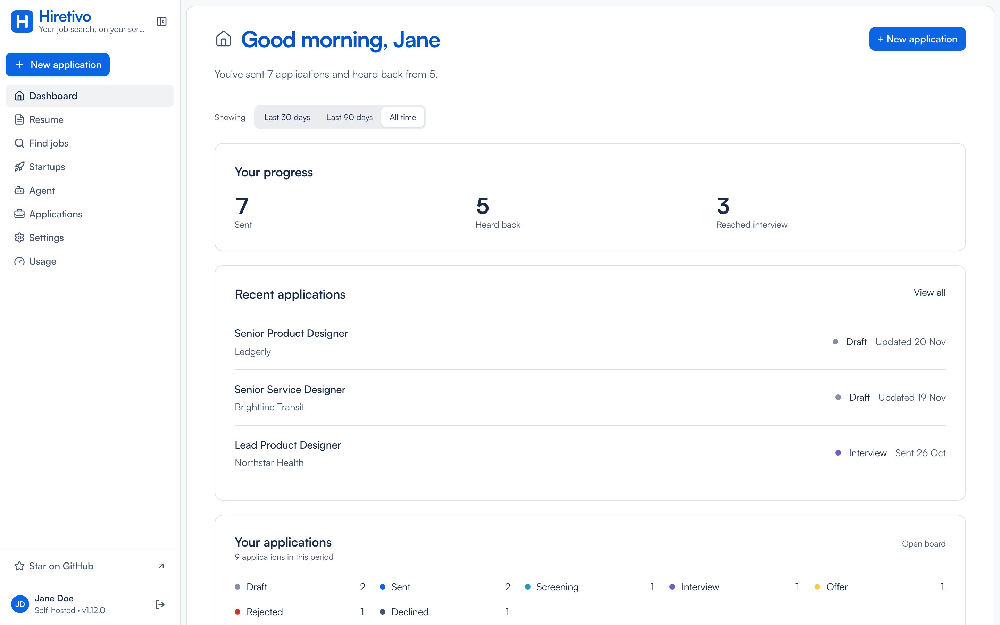
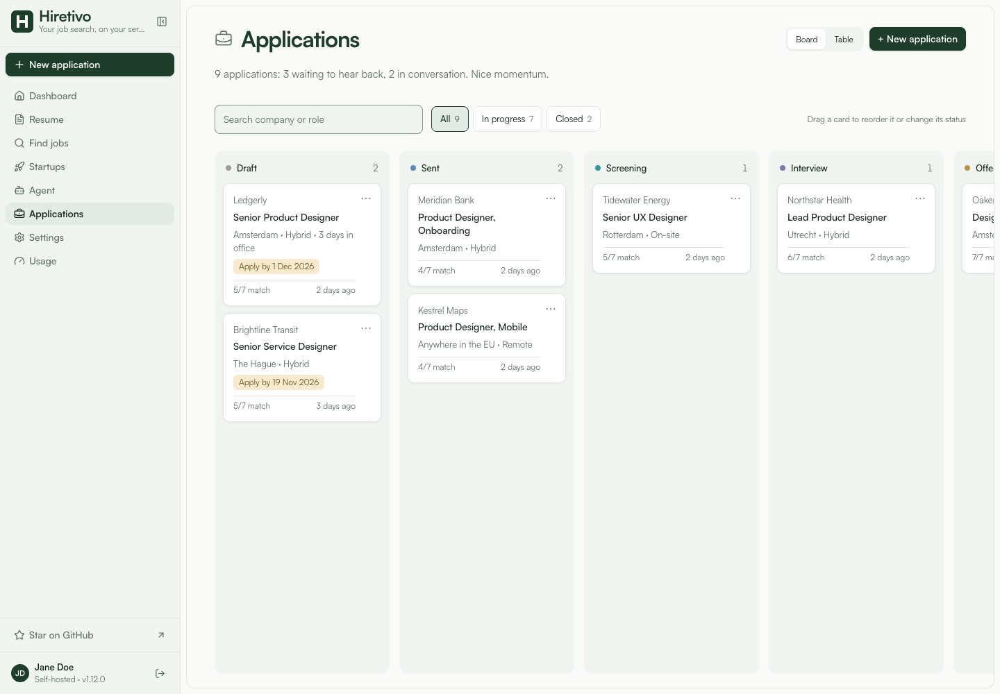

<p align="center"></p>
<h1 align="center">Hiretivo</h1>
<p align="center">Your profile, tailored resumes, and applications in one workspace.</p>
<p align="center"><a href="#run-locally-with-docker-recommended">Local setup</a> · <a href="DEVELOPMENT.md">Development</a> · <a href="LICENSE">AGPL-3.0 license</a></p>

Hiretivo helps you manage your job search: keep your career history in one profile, review how you match a job, create tailored resumes and cover letters, and track applications from draft to offer.

**Free to use. Bring your own API keys.** Hiretivo has no subscription or shared AI credits. Your chosen AI and job-search providers may charge for usage or impose limits. Manage those costs in their accounts.

## Recommended setup: run it on your computer

Use Docker with an ENV password. You do not need a Hiretivo account, email verification, Resend, Neon, or a public domain. Docker supplies the local PostgreSQL database and Chromium for PDF downloads. Docker itself is the only required runtime; you do not need Node or Yarn installed on your computer.

Your flow: start Docker → sign in with your ENV password → add your profile → connect an AI provider or local model → create and track applications.

There is no public hosted release of this version promised by these instructions. Hosted signup and deployment configuration are maintainer-only references in [DEVELOPMENT.md](DEVELOPMENT.md#maintainer-only-hosted-account-testing) and [HOSTING.md](HOSTING.md).

## Screenshots

Screenshots show the current green Hiretivo interface. Career and application details belong to a fictional demo profile, not a real applicant. The workspace screens show the recommended local self-hosted mode.

| Dashboard | Resume workspace |
| --- | --- |
|  |  |

| Applications | New application |
| --- | --- |
|  |  |

## What you can do

- **Build your profile:** add experience, skills, education, projects, certifications, publications, and facts. Review any imported resume information.
- **Create documents:** tailor a resume and cover letter to a posting, refine the drafts, choose document themes, and download PDFs. Review AI output before using it.
- **Track applications:** keep documents, notes, statuses, and interview dates together.
- **Find opportunities:** configure supported job sources, explore Startups, and review fit scores and reasons.
- **Choose your AI:** connect your own cloud API key, local model, or custom OpenAI-compatible endpoint.
- **Use optional integrations:** configure Google Calendar/Gmail features or connect an MCP app. Review permissions and task data before enabling integrations.
- **Keep control of your data:** export application data and manage stored app data from Settings.

## Run locally with Docker (recommended)

Install Git and Docker Desktop, or Docker Engine with Compose. Have at least 2 GB of available memory. On Windows, use WSL for the shell commands below. Keep port 3000 available, or change HIRETIVO_PORT in .env. The first build downloads dependencies and Chromium, so it can take several minutes.

```sh
git clone https://github.com/ignitinsharma/hiretivo.git
cd hiretivo
cp .env.example .env
docker run --rm node:24-trixie-slim node -e "console.log(require('node:crypto').randomBytes(32).toString('hex'))"
```

Edit `.env`: choose unique login and database passwords and paste the generated secret. Use letters, digits, and hyphens for the database password so it is safe in a connection URL. Do not commit this file.

```dotenv
HIRETIVO_DEPLOYMENT_MODE=self-hosted
HIRETIVO_PASSWORD=choose-a-long-unique-password
HIRETIVO_SECRET=paste-the-generated-secret
POSTGRES_PASSWORD=choose-another-long-unique-password
HIRETIVO_PORT=3000
```

```sh
docker compose up -d --build --wait
```

Compose starts PostgreSQL and sets the app's internal database address. The image includes generated database clients and Chromium. On startup, the app applies migrations, seeds built-in themes, and runs the production server. Open **http://localhost:3000**, enter your ENV password, and follow the welcome guide.

```sh
docker compose logs --tail=100 app
docker compose stop
docker compose start
```

PostgreSQL data is stored in the `pgdata` volume. Backups and generated download ZIPs are stored in the `appdata` volume. Keep your `HIRETIVO_SECRET` stable so saved API keys remain readable.

Stopping preserves these volumes. Removing volumes with `docker compose down -v` deletes their data. Keep backups.

### Updates, backups, and recovery

When upgrading an existing installation, retain its existing database username, database name, and password. If the previous Compose file used its default password, explicitly set `POSTGRES_PASSWORD=postgres` before starting this configuration; rotate it separately in PostgreSQL afterward.

Before updating, use **Settings → Your data → Export** and save the JSON outside Docker. Keep a private copy of `.env`, especially its encryption secret. Importing JSON replaces application data; test recovery with a separate installation first.

For a complete offline backup, stop the containers and back up both named volumes (`pgdata` and `appdata`) using Docker volume backup tooling, together with `.env`. Restore both volumes into a stopped installation using the same PostgreSQL major version. App exports are useful separately; they do not replace the database and ENV backup.

After backing up, update from the repository and rebuild:

```sh
git pull --ff-only
docker compose up -d --build --wait
```

To change your login password, edit `HIRETIVO_PASSWORD` and run `docker compose up -d --force-recreate app`. Keep `HIRETIVO_SECRET` unchanged: changing it prevents decryption of saved credentials.

### Troubleshooting

- **Docker unavailable:** start Docker Desktop or the Docker service; check `docker info`.
- **Port occupied:** change `HIRETIVO_PORT` and recreate the app container.
- **Startup or build fails:** inspect `docker compose logs --tail=100 app db` and the build output. Fill in required ENV values; allow more Docker memory if the build is killed.
- **PDF or storage failure:** inspect app logs. Chromium is included in the image; `/data` must remain writable by the container user. Rebuild the image after dependency updates.
- **Database fails:** check database logs and available disk space. Changing the ENV database password does not change an existing database user's password; retain the original value or deliberately rotate the database credential.

### Use a local model

For the optional Ollama service in this Compose setup:

```sh
docker compose up -d ollama
docker compose exec ollama ollama pull qwen2.5:3b
```

In **Settings → AI provider**, choose Local model, enter `http://ollama:11434`, select the downloaded model, and test the connection. Local-model speed and memory requirements depend on your hardware. Local models are available in self-hosted mode, not through the hosted website.

## Configuration and development

- [ENV examples](.env.example): available configuration without real credentials.
- [Maintainer hosting reference](HOSTING.md): optional hosted accounts and deployment details; not needed for local use.
- [Development](DEVELOPMENT.md): tooling and tests.
- [Privacy](PRIVACY.md) and [security](SECURITY.md): data handling and protection details.

The current backend uses an in-process job runner, schedules, and PDF browser. Its Docker/Node configuration expects one long-running application instance. Adapting those components for serverless hosting is separate work.

## License

Hiretivo is distributed under the [GNU Affero General Public License v3.0](LICENSE). Preserve license notices and third-party attribution when redistributing it. Bundled fonts retain their own licenses.
